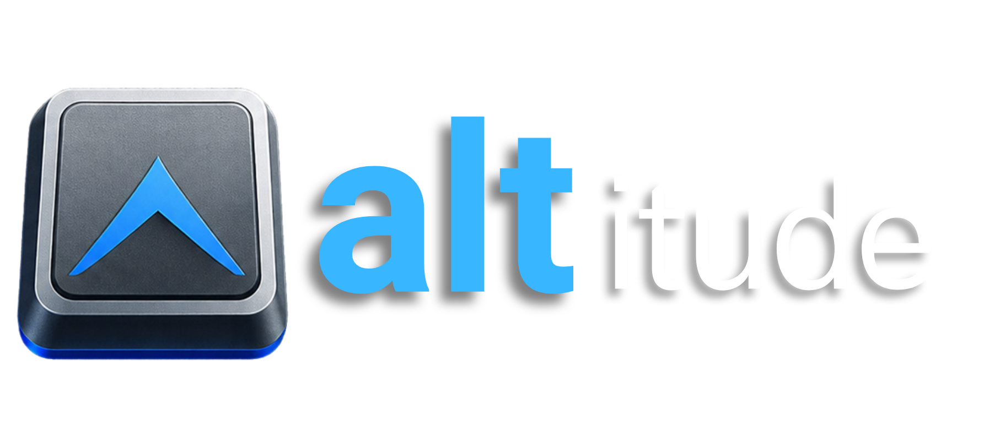

# Altitude



Menu bar agent for macOS that shows your Mission Control desktops and lets you jump between them (or move the focused window) with Option-digit hotkeys.

**Version:** 0.1.0 · **License:** MIT

## Features

- **Menu bar space indicator** — numbered desktop boxes with the current Space highlighted
- **Switch Spaces** — `⌥` + `1`…`N` jumps to desktop N
- **Move focused window** — `⌥⇧` + `1`…`N` moves the frontmost window to desktop N
- **Menu actions** — pick a desktop from the status menu; reload config; open config; Launch at Login; open Accessibility settings
- **Launch at Login** — checkable menu item (and `[app] launch_at_login` in TOML) registers via `SMAppService`; reload/relaunch reconciles the service to config
- **TOML config** — hotkeys, launch-at-login, and animation behavior under `~/.config/altitude/config.toml` (stow-friendly)
- **Optional instant switching** — skip the paced trackpad-like slide and jump as fast as the Dock allows
- **Instant trackpad, Control-arrows, Command-Tab, and external app activation** — optional (`disable_system_motions`). A horizontal Space swipe, Control-Left/Right, and Command-Tab cut to the destination with no slide. Activating an already-running app whose windows are on another Space on the same display (Raycast, Spotlight, Dock, Finder, `open`, etc.) hops to that Space with no slide and focuses the preferred window — the window stays on that Space. At the first or last Space on the active display, Control-Left/Right and swipe-previous/next do nothing (no edge bounce animation). Command-Tab shows a still row of open windows (including windows on other Spaces), so two windows of the same app both appear. While it is open, Left and Right move the highlight; Command-Q quits and Command-H hides the highlighted app. Escape cancels. Off by default so existing installs keep macOS motion
- **Accessibility-aware** — prompts once for Accessibility; later launches use the menu if permission is missing

## Requirements

- macOS (built as an `LSUIElement` accessory app)
- Xcode / `xcodebuild`
- **Accessibility** permission for Space switching and window moves (Dock-swipe / AX path)
- Apple Development identity for codesigning if you use `make` (keeps the Accessibility grant stable across rebuilds)

## Build & run

Copy the env example and set your signing identity (required for `make build` / `make run`):

```bash
cp .env.example .env
# Edit .env and set SIGN_ID, e.g. Apple Development: you@example.com (TEAMID)
# List identities with: security find-identity -v -p codesigning
```

`.env` is gitignored — do not commit it.

```bash
make test    # unsigned Domain XCTest suite (no SIGN_ID)
make build   # Debug build into ./build, then codesign
make run     # build and open Altitude.app
make install # force-quit running Altitude, Release-build, install to /Applications, open
make clean   # remove ./build
```

`make test` runs the Altitude scheme’s XCTest target with `CODE_SIGNING_ALLOWED=NO` (no Apple Development identity required). Pull requests targeting `main` run the same unsigned build+test path in GitHub Actions (`.github/workflows/ci.yml`).

`make install` force-quits every running Altitude instance (AppleScript quit, then `pkill` if needed), builds **Release**, codesigns with `SIGN_ID`, replaces `/Applications/Altitude.app`, and opens it. It does **not** fetch or check out git — you own the working tree before running it.

You can also override without a file: `make SIGN_ID="Apple Development: …" run`.

You can also open `Altitude.xcodeproj` in Xcode and run the **Altitude** scheme (Product → Test exercises `AltitudeTests`).

## Configuration

On first launch, if no config exists, Altitude copies the bundled example to:

```text
~/.config/altitude/config.toml
```

Example (`config/config.example.toml`):

```toml
version = 1

[app]
# When true, Altitude registers with macOS Login Items and starts at login.
# The menu bar "Launch at Login" item toggles this and writes it back to this file.
launch_at_login = false

[spaces]
# When true, switches jump as fast as the Dock allows instead of a slide per desktop.
disable_animations = false
# When true, trackpad Space swipes, Control-Left/Right, and Command-Tab cut straight across.
# Activating a running app on another same-display Space (Raycast, Spotlight, Dock, etc.)
# also hops there with no slide; the window is not moved onto the current Space.
# Command-Tab shows a still row of open windows instead of the system app switcher.
# Two windows of the same app both appear, including windows on other Spaces.
# Left and Right move the highlight while Command is held; Command-Q quits, Command-H hides.
# The highlighted name is that window's title. Off by default — set true to enable.
disable_system_motions = false

[hotkeys]
# option+N switches to desktop N; option+shift+N moves the focused window.
switch_enabled = true
move_enabled = true
# Highest desktop number that gets a hotkey (1...max). Clamped to existing Spaces at runtime.
max_space = 9
```

Use **Reload Config** in the menu bar menu after editing, or **Open Config…** to edit the file. Toggling **Launch at Login** writes `launch_at_login` immediately. If that write fails, Altitude beeps, leaves the file unchanged, and puts the Login Item back. Reload and relaunch reconcile the Login Item to the config value, including a registration still waiting for approval: the pending item stays while `launch_at_login` is true, and is removed when it is false. While macOS is waiting for approval in System Settings → General → Login Items, the menu item stays unchecked; clicking it cancels that pending registration.

## Permissions

1. Grant **Accessibility** to Altitude in System Settings → Privacy & Security → Accessibility.
2. Prefer a stable codesign identity (`make` default) so macOS keeps the same trust entry across rebuilds.
3. If hotkeys beep and nothing happens, open the status menu and use the Accessibility item.

## Limitations (v1)

- Desktops are flattened into a single 1-based list in Mission Control order.
- Switching to a Space on another display is not supported.
- Hotkeys are limited to digits `1`–`9` (further capped by `max_space` and the number of Spaces).
- With `disable_system_motions`, Command-Tab is handled by Altitude: hold Command, tap Tab or press Left/Right to move through windows (Shift-Tab reverses), release Command to land, Escape to cancel. Command-Q quits and Command-H hides the highlighted app; other keys are swallowed so they do not hit the app underneath. The first Tab after opening lands on the previous app (sibling windows of the frontmost app come later). Each open window is its own entry — including windows on other Spaces — and the highlighted one is the one that comes forward. Accessibility (current Space) and the window-server list (other Spaces) are merged; when both describe the same window under different titles, they collapse to one entry and the more specific title wins. Accessibility is authoritative for the current Space, so CG-only panels on that Space (and offscreen 500×500 / 800×600 helpers titled with the app name) are left out. The name is that window's title. Panels, tooltips, and the hidden helper windows some apps keep (Arc, Teams, Rex) are left out. The macOS app switcher does not appear. Menu-bar-only apps stay hidden, same as the system switcher.
- Horizontal Space swipes and Control-Left/Right move one Space with no slide. At the first Space, Left / swipe-previous is a no-op (no animation); at the last Space, Right / swipe-next is the same. A trackpad swipe commits when the finger lifts past a small travel threshold, so a reversed or aborted swipe cancels. Swipe direction follows the Dock's effective Space axis (natural scrolling already applied). Swipe-up Mission Control is unchanged. Control-Left/Right with Command, Option, or Shift is left to the app; key-repeat does not fire extra hops.
- With `disable_system_motions`, activating an already-running app on another Space on the same display (Raycast, Spotlight, Dock, Finder, `open`, and similar) hops to that Space with no slide and focuses the preferred window; the window is not moved onto the current Space. Cold launch (no windows yet), apps that live only on another display, Command-Tab sessions, and Altitude activating itself are left to macOS / the existing Command-Tab path. Stage Manager, Mission Control, and fullscreen are unchanged.
- An app that lives only on another display still switches the way macOS does.
- Trackpad, Control-arrow, Command-Tab, and external-activation suppression needs the same Accessibility grant as hotkey switching. It uses the Dock gesture path that works on macOS 26.

## Project layout

```text
Altitude/
├── Altitude/                 # App sources
│   ├── Backend/              # SkyLight / CGS / Dock-swipe switching
│   ├── Domain/               # Config, models, focus resolver
│   ├── Hotkeys/              # Carbon global hotkeys
│   └── UI/                   # Menu bar + space indicator
├── AltitudeTests/            # Domain-first XCTest suite
├── config/config.example.toml
├── .github/workflows/ci.yml  # Unsigned build+test on PRs to main
├── scripts/generate_pbxproj.py
├── Makefile
├── .env.example              # Template for local SIGN_ID (copy to .env)
├── AGENTS.md                 # Instructions for coding agents
└── README.md
```


## License

MIT — see [LICENSE](LICENSE).
